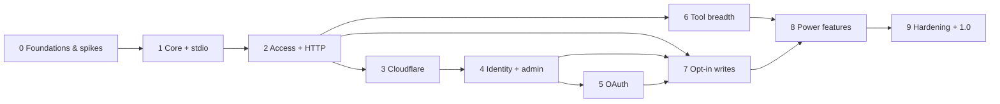

# Roadmap

> agility-bridge — an unofficial, open-source MCP server that gives AI agents safe access to **Digital.ai Agility**
> (every asset type, read and opt-in write) with each member's own access token. Runs locally (stdio), self-hosted
> (Node / Docker) or as a **Cloudflare Worker** reachable from every device.

Status: **Phase 6 built and reviewed** (2026-10-28) — v0.5.0 is published; v0.6 waits on the owner's OAuth client runs
(P6-14) and the Version Packages PR ([Phase 6 review](reviews/phase-6-review.md)). Phase 7 can start: it needs Phases 2,
4 and 5. Architecture:
[ARCHITECTURE.md](ARCHITECTURE.md) · Decisions: [adr/](adr/) · Facts & limits: [RESEARCH.md](RESEARCH.md) · Security:
[THREAT_MODEL.md](THREAT_MODEL.md) · Lessons: [LESSONS-LEARNED.md](LESSONS-LEARNED.md) · Task rules:
[tasks/README.md](tasks/README.md) · Open questions and owner steps: [pending-decisions/phase-6.md](pending-decisions/phase-6.md)

## Guiding principles

1. **Local-first, cloud-optional.** Every feature works without a Cloudflare account; the Worker is one deployment
   target among three.
2. **Runtime-agnostic core.** Web-standard APIs only in core packages; runtime code lives in adapters (ADR-0004).
3. **Read-only and least privilege by default.** Access is the intersection of workspace and grant; writes are a
   separate, opt-in product with human approval (ADR-0008, ADR-0013).
4. **Every asset type from day one, safely.** A validated generic query tool with bound parameters covers what typed
   tools do not; no raw API passthrough (ADR-0012).
5. **Security is a feature.** Threat model updated in the same PR as risky changes; tokens never leave the server
   unencrypted; Agility content is always untrusted.
6. **Built for agents.** One tool contract, compact outputs, actionable errors, honest partial results, a small
   catalogue (ADR-0015, L-005, L-155).
7. **Evidence before building, verification every phase.** Platform behaviour is measured in Phase 0 spikes against a
   real Agility sandbox and real clients; every phase ends with a review and a live pass (L-001, L-003, L-004).

## Phases at a glance

| Phase | Theme | What you can do afterwards | Release |
|---|---|---|---|
| **0** | Foundations, risk spikes, tool contract, sandbox | Repo public-ready; Agility API, SDK, clients, OAuth and Workers behaviour measured; tool contract frozen | — |
| **1** | Core engine + stdio | `npx agility-bridge` in every primary client; read **any** asset type (stories, defects, tasks, tests, epics, issues, requests, custom types) plus typed work-item, team and sprint tools | v0.1 |
| **2** | Access model + self-hosted HTTP | A team server (Node/Docker, SQLite) with per-workspace URLs, per-device tokens, encrypted bring-your-own tokens, audit log, admin API and CLI | v0.2 |
| **3** | Cloudflare Worker | The same server on Workers + D1, reachable from every device | v0.3 |
| **4** | Identity + admin panel | Google / GitHub / Cloudflare Access / OIDC sign-in; manage everything in the browser; members bring their own Agility tokens | v0.4 |
| **5** | OAuth 2.1 | claude.ai web, Claude mobile and IDEs connect with OAuth; per-device sessions | v0.5 |
| **6** | Tool breadth | Portfolio, sprints, conversations, history, reports, prompts, resources, evals | v0.6 |
| **7** | Opt-in writes | Comments, status, effort, owners, sprint moves, creating work items, field updates, close/reopen — approved by a person | v0.7 |
| **8** | Power features | Cache, deep links, MCP Apps charts, `doctor`, import/export, client plugins, telemetry, keychain, quotas, MCP Tasks | v0.8–0.9 |
| **9** | Hardening + launch | Final threat-model review, external review, performance, docs site, support policy | **v1.0** |

**Parallelism.** P0-10 (prior art) can run anytime. Phase 6 depends only on Phase 2, so tool breadth can run in parallel
with the remote platform (Phases 3–5) and its tasks are largely independent of each other. The write framework (P7-01)
needs Phase 2; the approval page (P7-02) needs the panel sessions (P4-02); the Phase 7 review needs OAuth (P5-10) to
verify the `mcp:write` scope end to end.

## How the lessons shaped this plan

The plan front-loads the work that is cheapest early and most expensive late ([LESSONS-LEARNED.md](LESSONS-LEARNED.md)):

- **An owner-decision gate before any Phase 0 work** (P0-14) settles the few choices that shape the repository, the
  sandbox and the tool contract (L-009).
- **A real Agility sandbox and a live-test harness in Phase 0** (P0-12), and a live pass at the end of every phase, not
  only before launch (L-003, L-004).
- **The tool contract and the default catalogue are frozen in Phase 0** (P0-11), with lints from Phase 1 (P1-13), so
  forty tools do not grow forty conventions (L-005, L-030, L-155).
- **The query compiler is a Phase 1 security component** with property tests (P1-04), because Agility's `with` binding
  is substitution, not a prepared statement (L-139) and quotas can count errors (L-138).
- **Both MCP protocol eras from the first spike** (P0-07): the two most common IDE clients do not speak the newest
  revision yet (L-011).
- **Release isolation, provenance and staged publishing in the first release** (P1-15), not as later fixes (L-127).
- **Security inventories from the first storage task** (P2-15), not a pre-launch retrofit (L-120).
- **Writes are designed with two approval channels** (elicitation and an out-of-band page, P7-01/P7-02) because the
  main IDE clients cannot be elicited over stateless HTTP (L-156).
- **Every phase reserves room for follow-ups**: review findings become new tasks in the same phase folder before its
  release.

## Releases

Each phase ends with a release (v0.1 … v0.9, then v1.0) **if the owner chooses per-phase releases** (pending decision
D-03); the alternative is to publish only from a later phase. Every release is published from GitHub Actions with npm
provenance, a GitHub Release with SBOM and checksums, and (from Phase 2) a signed container image.

## Decision log

| Date | Decision | Where |
|---|---|---|
| 2026-10-16 | Name `agility-bridge` (`AB_` variables, `ab_` tokens); Apache-2.0 with DCO; Markdown tasks and ADRs | ADR-0001 – 0003 |
| 2026-10-16 | Same architecture for every runtime: TypeScript monorepo, runtime-agnostic core, Hono; stdio, Node/Docker and Cloudflare Worker all in scope for 1.0 | ADR-0004, ADR-0005 |
| 2026-10-16 | Read-only by default; typed write tools opt-in per workspace/grant with human approval by default | ADR-0013 |
| 2026-10-16 | Typed tools **and** a validated, read-only generic query tool with bound parameters; no raw API passthrough | ADR-0012 |
| 2026-10-16 | Bring-your-own Agility token by default; shared tokens only for read-only grants; writes always with the caller's own token | ADR-0008 |
| 2026-10-16 | Hosted and on-premises Agility instances; HTTPS only (loopback for tests); custom CA bundles; access tokens only | ADR-0014 |
| 2026-10-16 | Primary clients documented equally: GitHub Copilot (VS Code, JetBrains, CLI), Claude (Code, Desktop, web, mobile), Cursor, Windsurf, MCP Inspector | ADR-0016 |
| 2026-10-16 | "Workspace" names agility-bridge's unit of access; "Agility project" always means Agility's `Scope` | ARCHITECTURE §4 |
| 2026-10-19 | Owner answered D-01 – D-24. Live tests use a read-only third-party tenant (writable sandbox needed before Phase 7); npm `agility-bridge`, Node ≥ 24, releases every phase; opt-in attachment download in 1.0 (deviates from the recommendation); all others as recommended | [pending-decisions/phase-0.md](pending-decisions/phase-0.md) |
| 2026-10-21 | MCP SDK v2, stateless HTTP, both protocol eras accepted on real-client evidence (P0-07) | ADR-0005 |
| 2026-10-21 | Agility API surface accepted with P0-06 amendments: JSON reads, no totals, comma-free scalar `with` values, `ID` sorts | ADR-0011 |
| 2026-10-21 | Tool contract final: conventions signed off, output contract accepted | ADR-0015, [tool conventions](dev/tool-conventions.md) |
| 2026-10-21 | Authentication accepted: device tokens first, OAuth 2.1 with workers-oauth-provider on both runtimes, refresh reuse window built in P5-05 | ADR-0009 |
| 2026-10-21 | Storage, encryption, access-model details and platform limits accepted; **Phase 0 complete, go for Phase 1** | ADR-0006, 0007, 0008, 0010, [Phase 0 results](research/phase-0-results.md) |
| 2026-10-21 | v0.1.0 published; live suite stays on demand (D-20); **go for Phase 2** (D-21) | [pending-decisions/phase-1.md](pending-decisions/phase-1.md) |

## Task index

Generated from task front matter by `pnpm tasks index`; `pnpm tasks lint` (in CI) fails when it is stale.
Status lives in each task file.

<!-- tasks:start -->
### Phase 0

| ID | Task | Priority | Depends on | Status |
|---|---|---|---|---|
| P0-01 | [Bootstrap the monorepo](tasks/phase-0-foundations/P0-01-repo-bootstrap.md) | high | P0-14 | done |
| P0-02 | [License, community and security policy files](tasks/phase-0-foundations/P0-02-license-community.md) | high | P0-01 | done |
| P0-03 | [CI pipeline](tasks/phase-0-foundations/P0-03-ci-pipeline.md) | high | P0-01 | done |
| P0-04 | [Security tooling baseline](tasks/phase-0-foundations/P0-04-security-tooling.md) | high | P0-03 | done |
| P0-05 | [Agent workflow and task tooling](tasks/phase-0-foundations/P0-05-agent-workflow.md) | high | P0-01 | done |
| P0-06 | [Spike: Agility API behaviour, limits and fixtures](tasks/phase-0-foundations/P0-06-spike-agility-api.md) | high | P0-01, P0-12 | done |
| P0-07 | [Spike: MCP SDK v2 dual-era handler with real clients](tasks/phase-0-foundations/P0-07-spike-mcp-sdk-clients.md) | high | P0-01 | done |
| P0-08 | [Spike: OAuth 2.1 portability on Node and Workers](tasks/phase-0-foundations/P0-08-spike-oauth.md) | high | P0-07 | done |
| P0-09 | [Spike: Cloudflare Workers limits with Agility-shaped payloads](tasks/phase-0-foundations/P0-09-spike-workers-limits.md) | high | P0-01 | done |
| P0-10 | [Prior-art review](tasks/phase-0-foundations/P0-10-prior-art-review.md) | medium | — | done |
| P0-11 | [Tool contract and conventions](tasks/phase-0-foundations/P0-11-tool-contract.md) | high | P0-06, P0-07, P0-14 | done |
| P0-12 | [Agility sandbox and live-verification harness](tasks/phase-0-foundations/P0-12-sandbox-live-harness.md) | high | P0-03, P0-14 | done |
| P0-13 | [Spike results and go/no-go for Phase 1](tasks/phase-0-foundations/P0-13-spike-results-go-no-go.md) | high | P0-02, P0-04, P0-05, P0-06, P0-07, P0-08, P0-09, P0-10, P0-11, P0-12 | done |
| P0-14 | [Owner decision gate for Phase 0](tasks/phase-0-foundations/P0-14-owner-decision-gate.md) | high | — | done |

### Phase 1

| ID | Task | Priority | Depends on | Status |
|---|---|---|---|---|
| P1-01 | [Core skeleton, tool registry and error model](tasks/phase-1-core-stdio/P1-01-core-skeleton.md) | high | P0-13 | done |
| P1-02 | [Agility HTTP client (instances, auth, retries, limiter, budget)](tasks/phase-1-core-stdio/P1-02-agility-client.md) | high | P1-01 | done |
| P1-03 | [Metadata service (meta.v1) and schema snapshot](tasks/phase-1-core-stdio/P1-03-metadata-service.md) | high | P1-02 | done |
| P1-04 | [Query builder, safety and limits](tasks/phase-1-core-stdio/P1-04-query-compiler.md) | high | P1-03 | done |
| P1-05 | [Output shaping v1 and untrusted-data envelope](tasks/phase-1-core-stdio/P1-05-output-shaping.md) | high | P1-01 | done |
| P1-06 | [Asset identity and name resolution](tasks/phase-1-core-stdio/P1-06-asset-identity.md) | high | P1-03, P1-04 | done |
| P1-07 | [Tools: whoami, list_projects, list_asset_types, describe_asset_type](tasks/phase-1-core-stdio/P1-07-tools-discovery.md) | high | P1-03, P1-05, P1-12 | done |
| P1-08 | [Tools: query_assets and get_assets](tasks/phase-1-core-stdio/P1-08-tools-generic-query.md) | high | P1-04, P1-05, P1-06, P1-12 | done |
| P1-09 | [Tools: search_work_items, get_work_item, list_my_work](tasks/phase-1-core-stdio/P1-09-tools-work-items.md) | high | P1-08 | done |
| P1-10 | [Tools: list_teams, get_team, list_sprints, list_members](tasks/phase-1-core-stdio/P1-10-tools-planning-context.md) | medium | P1-06, P1-08 | done |
| P1-11 | [CLI with stdio mode (environment and YAML configuration)](tasks/phase-1-core-stdio/P1-11-cli-stdio.md) | high | P1-07, P1-08 | done |
| P1-12 | [Test harness (fixtures, contract tests, probes, live suite)](tasks/phase-1-core-stdio/P1-12-test-harness.md) | high | P1-01, P0-12 | done |
| P1-13 | [Generated tool reference, naming and description lints, tools/list budget](tasks/phase-1-core-stdio/P1-13-tool-reference-lints.md) | medium | P0-11, P1-08 | done |
| P1-14 | [Docs: quickstart and client setup guides](tasks/phase-1-core-stdio/P1-14-docs-quickstart-clients.md) | high | P1-11 | blocked |
| P1-15 | [Release pipeline and v0.1.0](tasks/phase-1-core-stdio/P1-15-release-v0-1.md) | high | P1-09, P1-10, P1-11, P1-12, P1-13, P1-14 | done |
| P1-16 | [Phase 1 review and live verification](tasks/phase-1-core-stdio/P1-16-phase-1-review.md) | high | P1-15 | done |
| P1-17 | [Single-type paging counts upstream positions](tasks/phase-1-core-stdio/P1-17-paging-upstream-positions.md) | low | P1-16 | done |
| P1-18 | [Bind the cursor's time window and fix sprint timing per first page](tasks/phase-1-core-stdio/P1-18-cursor-window-binding.md) | low | P1-16 | done |
| P1-19 | [Return every date as UTC, including the non-UTC attribute variants](tasks/phase-1-core-stdio/P1-19-zoneless-dates.md) | medium | P1-16 | done |
| P1-20 | [Live check of the UTC date variants and the zone of the plain ones](tasks/phase-1-core-stdio/P1-20-live-check-utc-dates.md) | low | P1-19 | todo |

### Phase 2

| ID | Task | Priority | Depends on | Status |
|---|---|---|---|---|
| P2-01 | [Storage interface, schema and migrations](tasks/phase-2-access-http/P2-01-storage-schema-migrations.md) | high | P1-16 | done |
| P2-02 | [SQLite adapter for Node](tasks/phase-2-access-http/P2-02-sqlite-adapter.md) | high | P2-01 | done |
| P2-03 | [Secrets encryption and master-key rotation](tasks/phase-2-access-http/P2-03-secrets-encryption.md) | high | P2-01 | done |
| P2-04 | [Access model and effective-permission resolver](tasks/phase-2-access-http/P2-04-access-model.md) | high | P2-01, P2-03 | done |
| P2-05 | [Device access tokens](tasks/phase-2-access-http/P2-05-device-tokens.md) | high | P2-04 | done |
| P2-06 | [HTTP app (Hono) with per-workspace MCP endpoints](tasks/phase-2-access-http/P2-06-http-app.md) | high | P2-05 | done |
| P2-07 | [Rate limiting (pluggable)](tasks/phase-2-access-http/P2-07-rate-limiting.md) | high | P2-06 | done |
| P2-08 | [Audit log](tasks/phase-2-access-http/P2-08-audit-log.md) | high | P2-06 | done |
| P2-09 | [Admin REST API](tasks/phase-2-access-http/P2-09-admin-api.md) | high | P2-04, P2-05, P2-08 | done |
| P2-10 | [CLI management commands (local and remote)](tasks/phase-2-access-http/P2-10-cli-management.md) | medium | P2-09 | done |
| P2-11 | [Docker image](tasks/phase-2-access-http/P2-11-docker-image.md) | medium | P2-06 | done |
| P2-12 | [Authorization and isolation test suite](tasks/phase-2-access-http/P2-12-authz-isolation-suite.md) | high | P2-06 | done |
| P2-13 | [Agility credential validation](tasks/phase-2-access-http/P2-13-credential-validation.md) | medium | P2-03, P2-04 | done |
| P2-14 | [Pass-through workspaces (optional, off by default)](tasks/phase-2-access-http/P2-14-passthrough-mode.md) | low | P2-06, P2-08 | done |
| P2-15 | [Security inventories (cryptography, logging, data protection)](tasks/phase-2-access-http/P2-15-security-inventories.md) | medium | P2-03, P2-08 | done |
| P2-16 | [Self-hosting docs and executable-docs check](tasks/phase-2-access-http/P2-16-self-hosting-docs.md) | medium | P2-11 | done |
| P2-17 | [Phase 2 review and live verification](tasks/phase-2-access-http/P2-17-phase-2-review.md) | high | P2-02, P2-07, P2-10, P2-12, P2-13, P2-14, P2-15, P2-16 | done |
| P2-18 | [Publish the Docker image (signed, provenance, latest never backwards)](tasks/phase-2-access-http/P2-18-image-publishing.md) | medium | P2-11 | done |
| P2-19 | [Instance URL policy for servers (no plain HTTP, optional private-address refusal)](tasks/phase-2-access-http/P2-19-instance-url-policy.md) | medium | P2-13 | done |

### Phase 3

| ID | Task | Priority | Depends on | Status |
|---|---|---|---|---|
| P3-01 | [Worker entry, bindings and boot single-flight](tasks/phase-3-cloudflare/P3-01-worker-entry.md) | high | P2-17 | done |
| P3-02 | [D1 adapter and shared migration runner](tasks/phase-3-cloudflare/P3-02-d1-adapter.md) | high | P3-01 | done |
| P3-03 | [Workers limits presets and per-call budgets](tasks/phase-3-cloudflare/P3-03-workers-limits.md) | high | P3-01 | done |
| P3-04 | [Rate limiting on Workers](tasks/phase-3-cloudflare/P3-04-workers-rate-limiting.md) | medium | P3-01 | done |
| P3-05 | [Cloudflare setup script](tasks/phase-3-cloudflare/P3-05-cloudflare-setup.md) | high | P3-02 | done |
| P3-06 | [Worker test suite (workerd)](tasks/phase-3-cloudflare/P3-06-worker-tests.md) | medium | P3-02 | done |
| P3-07 | [Cloudflare docs (deploy, limits, costs, custom domain)](tasks/phase-3-cloudflare/P3-07-cloudflare-docs.md) | medium | P3-05 | done |
| P3-08 | [Scheduled jobs: audit purge and key rotation on D1](tasks/phase-3-cloudflare/P3-08-scheduled-jobs.md) | medium | P3-02 | done |
| P3-09 | [Self-hosted to Worker migration](tasks/phase-3-cloudflare/P3-09-migrate-to-worker.md) | low | P3-02 | done |
| P3-10 | [CPU benchmark and cost check](tasks/phase-3-cloudflare/P3-10-cpu-benchmark.md) | low | P3-03 | done |
| P3-11 | [Phase 3 review and staging verification](tasks/phase-3-cloudflare/P3-11-phase-3-review.md) | high | P3-04, P3-06, P3-07, P3-08, P3-09, P3-10 | done |
| P3-12 | [Optional exact rate limiter on a Durable Object](tasks/phase-3-cloudflare/P3-12-durable-object-limiter.md) | low | P3-04 | todo |
| P3-13 | [Master-key status and retirement through the admin API; init --version](tasks/phase-3-cloudflare/P3-13-remote-key-admin.md) | medium | P3-08 | done |
| P3-14 | [Cut the Worker's cold-start CPU under the Free plan's budget](tasks/phase-3-cloudflare/P3-14-cold-start-cpu.md) | high | P3-10 | done |

### Phase 4

| ID | Task | Priority | Depends on | Status |
|---|---|---|---|---|
| P4-01 | [Identity providers and owner bootstrap](tasks/phase-4-identity-admin/P4-01-identity-providers.md) | high | P3-11 | done |
| P4-02 | [Admin sessions, roles, CSRF and re-authentication](tasks/phase-4-identity-admin/P4-02-admin-sessions.md) | high | P4-01 | done |
| P4-03 | [Admin UI scaffold](tasks/phase-4-identity-admin/P4-03-admin-ui-scaffold.md) | high | P4-02 | done |
| P4-04 | [Admin screens: instances, credentials, workspaces, grants, tokens, users](tasks/phase-4-identity-admin/P4-04-admin-screens.md) | high | P4-03 | done |
| P4-05 | [Audit viewer and usage statistics](tasks/phase-4-identity-admin/P4-05-audit-viewer.md) | medium | P4-03 | done |
| P4-06 | [Connect page with client snippets](tasks/phase-4-identity-admin/P4-06-connect-page.md) | medium | P4-04, P4-07 | done |
| P4-07 | [Member self-service: bring your own Agility token](tasks/phase-4-identity-admin/P4-07-member-self-service.md) | high | P4-04 | done |
| P4-08 | [Browser E2E and DAST baseline](tasks/phase-4-identity-admin/P4-08-e2e-dast.md) | medium | P4-04, P4-05, P4-07 | done |
| P4-09 | [Admin security review (owner boundaries on every writer)](tasks/phase-4-identity-admin/P4-09-admin-security-review.md) | high | P4-04, P4-05, P4-06, P4-07, P4-12, P4-13, P4-15 | done |
| P4-10 | [Admin documentation](tasks/phase-4-identity-admin/P4-10-admin-docs.md) | medium | P4-04 | done |
| P4-11 | [Phase 4 review](tasks/phase-4-identity-admin/P4-11-phase-4-review.md) | high | P4-08, P4-09, P4-10 | done |
| P4-12 | [Move a user to another identity on purpose (owner-only unbind)](tasks/phase-4-identity-admin/P4-12-unbind-identity.md) | medium | P4-02, P4-04 | done |
| P4-13 | [pnpm cf:setup prompts for the sign-in settings](tasks/phase-4-identity-admin/P4-13-cf-setup-sign-in.md) | low | P4-01 | done |
| P4-14 | [CPU benchmark scenarios for the panel](tasks/phase-4-identity-admin/P4-14-panel-benchmark-scenarios.md) | low | P4-03 | done |
| P4-15 | [Panel follow-ups: enable a disabled user, list every device token, edit number prefixes](tasks/phase-4-identity-admin/P4-15-panel-follow-ups.md) | low | P4-04, P4-12 | done |
| P4-24 | [Unbind to a named provider: narrow who can claim the account](tasks/phase-4-identity-admin/P4-24-unbind-to-named-provider.md) | low | P4-12 | todo |
| P4-28 | [Panel list screens: cost grows with the number of users](tasks/phase-4-identity-admin/P4-28-panel-list-screen-cost.md) | low | P4-14 | todo |
| P4-30 | [Apply an instance's stored number prefixes when resolving numbers](tasks/phase-4-identity-admin/P4-30-apply-stored-number-prefixes.md) | low | P4-15 | done |
| P4-31 | [Keyset paging for device tokens in storage](tasks/phase-4-identity-admin/P4-31-token-list-storage-keyset.md) | low | P4-15 | done |
| P4-34 | [Make adding an instance an owner-only action (if D-55 chooses it)](tasks/phase-4-identity-admin/P4-34-owner-only-instance-creation.md) | low | P4-09 | dropped |
| P4-35 | [List and revoke unused owner setup links (if D-56 chooses it)](tasks/phase-4-identity-admin/P4-35-list-revoke-setup-links.md) | low | P4-09 | dropped |
| P4-36 | [Write the audit row before an admin change and refuse the change without it (if D-57 chooses it)](tasks/phase-4-identity-admin/P4-36-audit-before-admin-changes.md) | low | P4-09 | dropped |
| P4-37 | [Record a credential validation only while the sealed token is the one that was checked](tasks/phase-4-identity-admin/P4-37-validation-compare-and-swap.md) | low | P4-09 | todo |

### Phase 5

| ID | Task | Priority | Depends on | Status |
|---|---|---|---|---|
| P5-01 | [OAuth 2.1 authorization server](tasks/phase-5-oauth/P5-01-oauth-server.md) | high | P4-11 | done |
| P5-02 | [Protected resource metadata per workspace](tasks/phase-5-oauth/P5-02-protected-resource-metadata.md) | high | P5-01 | done |
| P5-03 | [Client registration: CIMD and DCR](tasks/phase-5-oauth/P5-03-client-registration.md) | high | P5-02 | done |
| P5-04 | [Consent screen and device handling](tasks/phase-5-oauth/P5-04-consent-devices.md) | high | P5-01 | done |
| P5-05 | [Token lifecycle and refresh concurrency](tasks/phase-5-oauth/P5-05-token-lifecycle.md) | high | P5-01 | done |
| P5-06 | [Real-client compatibility matrix (OAuth)](tasks/phase-5-oauth/P5-06-client-matrix-oauth.md) | high | P5-02, P5-03, P5-04, P5-05 | done |
| P5-07 | [OAuth documentation](tasks/phase-5-oauth/P5-07-oauth-docs.md) | medium | P5-06 | done |
| P5-08 | [Admin: connected apps and devices](tasks/phase-5-oauth/P5-08-admin-oauth-apps.md) | medium | P5-05 | done |
| P5-09 | [Abuse controls for unauthenticated endpoints](tasks/phase-5-oauth/P5-09-oauth-abuse-controls.md) | medium | P5-03 | done |
| P5-10 | [Phase 5 review](tasks/phase-5-oauth/P5-10-phase-5-review.md) | high | P5-07, P5-08, P5-09 | done |
| P5-13 | [Remembered read consent (opt-in)](tasks/phase-5-oauth/P5-13-remembered-consent.md) | low | P5-04, P5-05 | todo |
| P5-14 | [Device last-used time and idle expiry](tasks/phase-5-oauth/P5-14-device-last-used.md) | low | P5-04, P5-05 | done |
| P5-15 | [Private-use scheme redirects for desktop clients](tasks/phase-5-oauth/P5-15-private-use-redirects.md) | low | P5-06 | todo |
| P5-16 | [Metadata document policy extras](tasks/phase-5-oauth/P5-16-client-document-policy.md) | low | P5-06 | done |
| P5-19 | [Edge rate limits for the OAuth routes on Workers](tasks/phase-5-oauth/P5-19-oauth-edge-rate-limits.md) | low | P5-09 | todo |
| P5-20 | [Operator view of OAuth abuse refusals and caps](tasks/phase-5-oauth/P5-20-oauth-abuse-visibility.md) | low | P5-08, P5-09 | done |
| P5-21 | [Keep the device when an issuance refusal can pass](tasks/phase-5-oauth/P5-21-recoverable-issuance-refusals.md) | low | P5-10 | done |
| P5-22 | [Key the OAuth abuse counters with a secret](tasks/phase-5-oauth/P5-22-keyed-address-hash.md) | low | P5-10 | dropped |
| P5-23 | [Metadata document clients with ports or key-based authentication](tasks/phase-5-oauth/P5-23-cimd-ports-and-key-clients.md) | low | P5-16 | todo |

### Phase 6

| ID | Task | Priority | Depends on | Status |
|---|---|---|---|---|
| P6-01 | [Portfolio tools (epics and portfolio items)](tasks/phase-6-tool-breadth/P6-01-tools-portfolio.md) | high | P2-17 | done |
| P6-02 | [Planning tools (get_sprint)](tasks/phase-6-tool-breadth/P6-02-tools-planning.md) | high | P2-17 | done |
| P6-03 | [Quality views (tests, regression assets, defects)](tasks/phase-6-tool-breadth/P6-03-tools-quality.md) | medium | P2-17, P6-09 | done |
| P6-04 | [Collaboration tools (conversations, links, attachments)](tasks/phase-6-tool-breadth/P6-04-tools-collaboration.md) | medium | P2-17 | done |
| P6-05 | [History and activity tools](tasks/phase-6-tool-breadth/P6-05-tools-history.md) | medium | P2-17 | done |
| P6-06 | [Requests, issues, goals, themes and retrospectives through the generic tools](tasks/phase-6-tool-breadth/P6-06-other-asset-types.md) | medium | P2-17 | done |
| P6-07 | [Composite reports](tasks/phase-6-tool-breadth/P6-07-composite-reports.md) | high | P6-01, P6-02, P6-05 | done |
| P6-08 | [MCP prompts (workflows)](tasks/phase-6-tool-breadth/P6-08-mcp-prompts.md) | medium | P6-07 | done |
| P6-09 | [MCP resources](tasks/phase-6-tool-breadth/P6-09-mcp-resources.md) | medium | P2-17 | done |
| P6-10 | [Tool evaluations](tasks/phase-6-tool-breadth/P6-10-tool-evals.md) | medium | P6-07 | done |
| P6-11 | [Cost accounting and composite grants](tasks/phase-6-tool-breadth/P6-11-cost-composite-grants.md) | medium | P6-07 | done |
| P6-12 | [Consistency pass (arguments, outputs, paging, tool count)](tasks/phase-6-tool-breadth/P6-12-consistency-pass.md) | medium | P6-07, P6-08, P6-09 | done |
| P6-13 | [Phase 6 review and live verification](tasks/phase-6-tool-breadth/P6-13-phase-6-review.md) | high | P6-03, P6-04, P6-06, P6-10, P6-11, P6-12 | review |
| P6-14 | [OAuth client matrix for the remaining clients](tasks/phase-6-tool-breadth/P6-14-oauth-client-matrix-rest.md) | medium | P5-06 | todo |
| P6-15 | [Server-side aggregate roll-ups for the portfolio tree](tasks/phase-6-tool-breadth/P6-15-portfolio-aggregate-rollups.md) | low | P6-01 | done |
| P6-16 | [Portfolio tree for very large epics (per-child roll-ups)](tasks/phase-6-tool-breadth/P6-16-portfolio-tree-large-epics.md) | low | P6-01 | done |
| P6-17 | [Sprint capacity, velocity and hour-based burndown](tasks/phase-6-tool-breadth/P6-17-sprint-capacity-velocity.md) | low | P6-02 | todo |
| P6-18 | [Burndown for sprints with hundreds of items](tasks/phase-6-tool-breadth/P6-18-sprint-burndown-large-sprints.md) | medium | P6-02 | done |
| P6-19 | [Verify the attachment download on a writable sandbox](tasks/phase-6-tool-breadth/P6-19-verify-attachment-download.md) | medium | P6-04 | todo |
| P6-20 | [Ranged reads of long attachment text](tasks/phase-6-tool-breadth/P6-20-attachment-ranged-reads.md) | low | P6-04 | done |
| P6-21 | [Verify history against known edits on the writable sandbox](tasks/phase-6-tool-breadth/P6-21-history-sandbox-verification.md) | medium | P6-05, P7-07 | todo |
| P6-22 | [Portfolio items in list_recent_changes](tasks/phase-6-tool-breadth/P6-22-recent-changes-portfolio-items.md) | low | P6-05, P6-01 | done |
| P6-25 | [Verify the regression and test-set recipes on the writable sandbox](tasks/phase-6-tool-breadth/P6-25-verify-regression-recipes-sandbox.md) | low | P6-03, P7-07 | todo |
| P6-26 | [Revisit a typed quality tool after the tool evals](tasks/phase-6-tool-breadth/P6-26-quality-typed-tool-revisit.md) | low | P6-03, P6-10 | done |
| P6-27 | [Verify requests and empty asset types on a writable sandbox](tasks/phase-6-tool-breadth/P6-27-verify-requests-on-sandbox.md) | low | P6-06 | todo |
| P6-28 | [Decide on typed tools for issues and requests from usage and evals](tasks/phase-6-tool-breadth/P6-28-typed-tools-for-other-types.md) | low | P6-06, P6-10 | todo |
| P6-29 | [Quality scan over a sprint or epic](tasks/phase-6-tool-breadth/P6-29-quality-batch-scan.md) | low | P6-07 | todo |
| P6-30 | [Priority and severity in defect triage](tasks/phase-6-tool-breadth/P6-30-defect-priority-severity-triage.md) | low | P6-07 | todo |
| P6-31 | [Prompt fallbacks without the reports group](tasks/phase-6-tool-breadth/P6-31-prompt-fallbacks-without-reports.md) | low | P6-08 | dropped |
| P6-32 | [Prompt argument completion](tasks/phase-6-tool-breadth/P6-32-prompt-argument-completion.md) | low | P6-08 | done |
| P6-33 | [First LLM tool-eval run and triage](tasks/phase-6-tool-breadth/P6-33-first-llm-eval-run.md) | medium | P6-10 | done |
| P6-34 | [Tune tool descriptions from the eval misses](tasks/phase-6-tool-breadth/P6-34-description-tuning-from-evals.md) | low | P6-33 | todo |
| P6-35 | [Live composite warnings in the workspace and grant forms](tasks/phase-6-tool-breadth/P6-35-live-composite-warnings-in-forms.md) | low | P6-11 | done |
| P6-36 | [Name the tools hidden by the per-call budget](tasks/phase-6-tool-breadth/P6-36-budget-hidden-tools-in-whoami.md) | low | P6-11 | done |
| P6-37 | [Report schema-validation failures as AB_INPUT_INVALID tool errors](tasks/phase-6-tool-breadth/P6-37-consistency-schema-errors.md) | low | P6-12 | done |
| P6-38 | [Run the consistency checks on an empty and a denied world](tasks/phase-6-tool-breadth/P6-38-consistency-empty-world.md) | low | P6-12 | done |
| P6-39 | [Keep instance metadata across isolates and measure Phase 6 tools on the Worker bench](tasks/phase-6-tool-breadth/P6-39-keep-instance-metadata-across-isolates-and-measure.md) | medium | P6-13 | done |
| P6-40 | [Run independent report sections together and share resolution within a request](tasks/phase-6-tool-breadth/P6-40-run-independent-report-sections-together-and-share.md) | medium | P6-13, P6-07 | done |
| P6-41 | [Read sprint pages and burndown history concurrently](tasks/phase-6-tool-breadth/P6-41-read-sprint-pages-and-burndown-history-concurrentl.md) | low | P6-13, P6-02 | done |
| P6-42 | [Let a burndown chunk that is too large mark its points incomplete](tasks/phase-6-tool-breadth/P6-42-let-a-burndown-chunk-that-is-too-large-mark-its-po.md) | low | P6-13, P6-02 | done |
| P6-43 | [Read long asset histories within the response cap](tasks/phase-6-tool-breadth/P6-43-read-long-asset-histories-within-the-response-cap.md) | medium | P6-13, P6-21 | todo |
| P6-44 | [Cut the core test suite's runtime](tasks/phase-6-tool-breadth/P6-44-cut-the-core-test-suite-s-runtime.md) | low | P6-13 | done |
| P6-45 | [Remove the duplicated tool helpers and the double meaning of `minimal_output`](tasks/phase-6-tool-breadth/P6-45-remove-the-duplicated-tool-helpers-and-the-double.md) | low | P6-13, P6-12 | done |
| P6-46 | [Settle the edge semantics of `work_item_quality`](tasks/phase-6-tool-breadth/P6-46-settle-the-edge-semantics-of-work-item-quality.md) | low | P6-13, P6-03 | todo |
| P6-47 | [Polish defect triage, standup and get_sprint output details](tasks/phase-6-tool-breadth/P6-47-polish-defect-triage-standup-and-get-sprint-output.md) | low | P6-13 | todo |
| P6-48 | [Forward sibling facts in composites as codes, with a lint](tasks/phase-6-tool-breadth/P6-48-forward-sibling-facts-in-composites-as-codes-with.md) | low | P6-13, P6-07 | done |
| P6-51 | [Live check of the get_sprint read shapes](tasks/phase-6-tool-breadth/P6-51-live-check-of-the-sprint-read-shapes.md) | low | P6-41, P6-42, P6-18 | todo |
| P6-52 | [Sprint burndown by aggregation for very large sprints](tasks/phase-6-tool-breadth/P6-52-sprint-burndown-by-aggregation.md) | low | P6-18 | todo |
| P6-55 | [Filter standup_summary on the change date instead of reading the newest page](tasks/phase-6-tool-breadth/P6-55-standup-change-date-filter.md) | low | P6-40, P6-27 | todo |
| P6-58 | [Show the budget-hidden tools note for an inherited call budget in the panel](tasks/phase-6-tool-breadth/P6-58-panel-inherited-call-budget-note.md) | low | P6-36 | todo |

### Phase 7

| ID | Task | Priority | Depends on | Status |
|---|---|---|---|---|
| P7-01 | [Write framework (enablement, approval, dry run, audit intent)](tasks/phase-7-writes/P7-01-write-framework.md) | high | P2-17, P0-07 | todo |
| P7-02 | [Out-of-band approval page](tasks/phase-7-writes/P7-02-approval-page.md) | high | P7-01, P4-02 | todo |
| P7-03 | [Deployment-wide write limiter](tasks/phase-7-writes/P7-03-write-limiter.md) | high | P7-01 | todo |
| P7-04 | [Writes wave 1: comment, status, effort, owners, sprint](tasks/phase-7-writes/P7-04-writes-wave-1.md) | high | P7-01, P7-03 | todo |
| P7-05 | [Writes wave 2: create work items and update fields](tasks/phase-7-writes/P7-05-writes-wave-2.md) | medium | P7-04 | todo |
| P7-06 | [Lifecycle operations: close and reopen](tasks/phase-7-writes/P7-06-lifecycle-operations.md) | medium | P7-04 | todo |
| P7-07 | [Sandbox write verification](tasks/phase-7-writes/P7-07-sandbox-write-verification.md) | high | P7-02, P7-05, P7-06 | todo |
| P7-08 | [Write documentation and threat-model update](tasks/phase-7-writes/P7-08-write-docs-threat-model.md) | medium | P7-07 | todo |
| P7-09 | [Phase 7 review](tasks/phase-7-writes/P7-09-phase-7-review.md) | high | P7-08, P5-10 | todo |

### Phase 8

| ID | Task | Priority | Depends on | Status |
|---|---|---|---|---|
| P8-01 | [Query cache](tasks/phase-8-power-features/P8-01-query-cache.md) | medium | P6-13 | todo |
| P8-02 | [Deep links to the Agility UI](tasks/phase-8-power-features/P8-02-deep-links.md) | low | P6-13 | todo |
| P8-03 | [MCP Apps views](tasks/phase-8-power-features/P8-03-mcp-apps-views.md) | low | P6-13 | todo |
| P8-04 | [doctor command](tasks/phase-8-power-features/P8-04-doctor.md) | medium | P6-13 | todo |
| P8-05 | [Configuration import and export](tasks/phase-8-power-features/P8-05-config-import-export.md) | low | P6-13 | todo |
| P8-06 | [Client integrations (Claude Code plugin, VS Code and Copilot snippets)](tasks/phase-8-power-features/P8-06-client-integrations.md) | low | P6-13 | todo |
| P8-07 | [Self-monitoring with OpenTelemetry](tasks/phase-8-power-features/P8-07-self-monitoring.md) | low | P6-13 | todo |
| P8-08 | [OS keychain support](tasks/phase-8-power-features/P8-08-os-keychain.md) | low | P6-13 | todo |
| P8-09 | [Per-grant quotas and usage](tasks/phase-8-power-features/P8-09-quotas-usage.md) | low | P6-13 | todo |
| P8-10 | [MCP Tasks for long-running reports](tasks/phase-8-power-features/P8-10-mcp-tasks.md) | low | P6-13 | todo |
| P8-11 | [Lazy auth and public tool catalogue](tasks/phase-8-power-features/P8-11-lazy-auth-catalogue.md) | low | P6-13 | todo |
| P8-12 | [Phase 8 review](tasks/phase-8-power-features/P8-12-phase-8-review.md) | high | P8-01, P8-02, P8-03, P8-04, P8-05, P8-06, P8-07, P8-08, P8-09, P8-10, P8-11, P7-09 | todo |

### Phase 9

| ID | Task | Priority | Depends on | Status |
|---|---|---|---|---|
| P9-01 | [Threat model final review and evidence map](tasks/phase-9-hardening-launch/P9-01-threat-model-final.md) | high | P8-12 | todo |
| P9-02 | [External security review](tasks/phase-9-hardening-launch/P9-02-external-review.md) | high | P9-01 | todo |
| P9-03 | [Performance and cost review](tasks/phase-9-hardening-launch/P9-03-performance-cost.md) | medium | P8-12 | todo |
| P9-04 | [Documentation site](tasks/phase-9-hardening-launch/P9-04-docs-site.md) | medium | P8-12 | todo |
| P9-05 | [Support, versioning and deprecation policy](tasks/phase-9-hardening-launch/P9-05-support-policy.md) | medium | P8-12 | todo |
| P9-06 | [ASVS L2 mapping and OpenSSF Best Practices](tasks/phase-9-hardening-launch/P9-06-asvs-openssf.md) | medium | P9-01 | todo |
| P9-07 | [Release verification guide and backport path](tasks/phase-9-hardening-launch/P9-07-release-verification-backports.md) | medium | P8-12 | todo |
| P9-08 | [Launch checklist and 1.0.0](tasks/phase-9-hardening-launch/P9-08-launch-1-0.md) | high | P9-02, P9-03, P9-04, P9-05, P9-06, P9-07 | todo |
<!-- tasks:end -->
